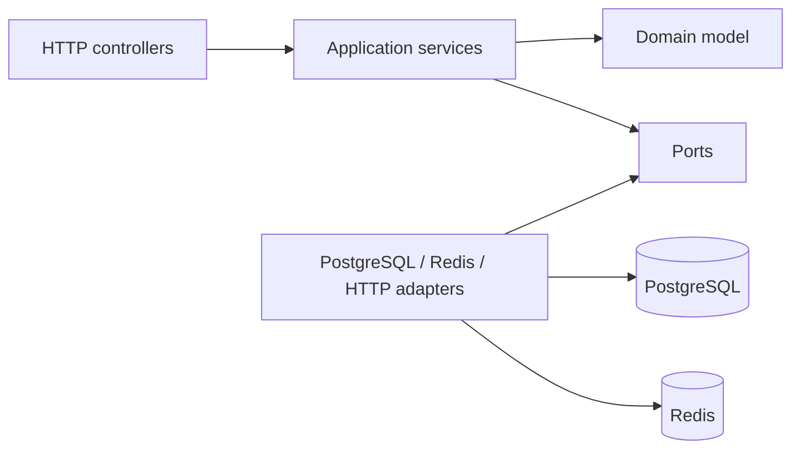

# Wallet & Ledger API

[](https://github.com/valeriibb/wallet-ledger-api/actions/workflows/ci.yml)

A portfolio backend project for multi-currency wallets. I built it to practise the parts of financial systems that a normal CRUD project does not cover: immutable ledger entries, concurrent requests, idempotency, reliable events, reconciliation, and exact currency conversion.

## Stack

- PHP 8.4 and Laravel 13
- PostgreSQL 18
- Redis
- Docker Compose and Nginx
- PHPUnit, PHPStan, Laravel Pint, and Infection
- GitHub Actions

## What the API does

- Sanctum registration and authentication
- Wallet opening, balances, and cursor-paginated statements
- Transfers, deposits, withdrawals, fees, and reversals
- Multi-currency conversion with exact decimal rates and explicit rounding metadata
- Idempotency keys for money-moving requests
- Transactional outbox and signed webhook delivery
- Retry, dead-letter, and manual webhook replay flows
- Reconciliation reports that detect corrupted balances and stale events
- RFC 9457 Problem Details and request IDs

The complete HTTP contract is in [`docs/openapi.json`](docs/openapi.json).

## Architecture

The domain layer contains money and ledger rules without Laravel dependencies. Application services depend on ports. PostgreSQL, Redis, HTTP, and Laravel code live in adapters and are connected in the service provider.



Example:

```text
ConvertCurrency         -> application service
ConversionStore         -> port
PostgresConversionStore -> adapter
AppServiceProvider      -> composition root
```

## Ledger model

Money is stored as integer minor units. Ledger entries are immutable. Every transaction must balance separately in each currency.

A USD to EUR conversion creates four entries in one database transaction:

```text
USD: user wallet  --debit-->  system FX account
EUR: system FX    --debit-->  user wallet
```

The exact rate, its source, validity time, rounded result, and fractional rounding difference are saved in transaction metadata.

## Concurrency and failure handling

I chose ordered PostgreSQL `FOR UPDATE` locks because balances must be checked and changed atomically. Accounts are locked in UUID order to reduce deadlocks. PostgreSQL serialization and deadlock errors receive a small bounded retry.

An idempotency key and request hash prevent the same request from moving money twice. The stored response is committed with the ledger transaction.

Events use a transactional outbox. A ledger change and its pending event commit together, so a worker crash cannot silently lose the event. Delivery is at least once; event IDs let consumers deduplicate.

The decisions and rejected alternatives are documented in [`docs/adr`](docs/adr).

## Run locally

Requirements: Docker Desktop and Docker Compose.

```bash
git clone https://github.com/valeriibb/wallet-ledger-api.git
cd wallet-ledger-api
cp .env.example .env
docker compose up -d --build
docker compose exec php composer install
docker compose exec php php artisan key:generate
docker compose exec php php artisan migrate
```

The API is available at `http://127.0.0.1:8080`.

Mailpit is available at `http://127.0.0.1:8025`.

## Quality checks

```bash
make test
make test-concurrency
make lint
make analyse
make mutate
```

Current suite: **153 tests and 145,993 assertions**, including real PostgreSQL concurrency, process-crash, property-style, integration, feature, and architecture tests.

CI runs formatting, PHPStan at maximum level, migrations, PHPUnit, and the Money mutation score on every push and pull request.

## Main design notes

- [`ADR 0003 - Ledger store`](docs/adr/0003-ledger-store.md)
- [`ADR 0005 - Transfer isolation and locking`](docs/adr/0005-transfer-isolation-and-locking.md)
- [`ADR 0006 - Idempotency`](docs/adr/0006-idempotency.md)
- [`ADR 0007 - Transactional outbox`](docs/adr/0007-transactional-outbox.md)
- [`ADR 0010 - Exchange-rate rounding`](docs/adr/0010-exchange-rate-rounding.md)
- [`ADR 0011 - Atomic currency conversion`](docs/adr/0011-atomic-currency-conversion.md)
